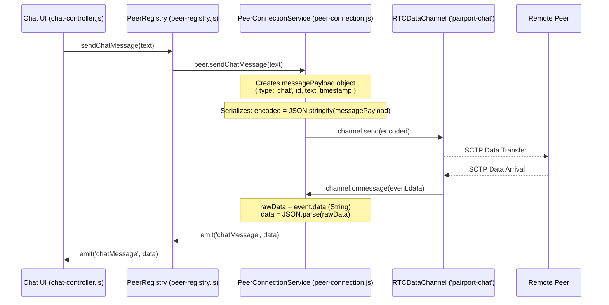

# PairPort Network Lab — Source Audit & Implementation Plan

**Date:** 2026-10-29  
**Version:** 1.0.0  
**Scope:** Phase 0 Source Audit, In-App Application-Level Inspection Architecture, and External Packet Capture Protocol.

---

## 1. Current Architecture & Verified Source Paths

PairPort operates as a peer-to-peer browser application leveraging a central FastAPI signaling service for WebRTC session negotiation and connection coordination. Application data (chat messages and chunked binary file streams) flows strictly over direct or relay-backed WebRTC SCTP DataChannels without ever touching the signaling server.

### Verified Frontend Source Paths
- **Peer Mesh Registry:** [`frontend/src/services/peer-registry.js`](file:///c:/Users/SOHAN/Desktop/PairPort/frontend/src/services/peer-registry.js) — Coordinates a full-mesh WebRTC topology for up to 4 participants (up to 3 remote peer connections per device). Manages peer lifecycle, deterministic initiator negotiation, broadcast chat, and multi-recipient file transfer dispatching.
- **Peer Connection Service:** [`frontend/src/services/peer-connection.js`](file:///c:/Users/SOHAN/Desktop/PairPort/frontend/src/services/peer-connection.js) — Implements `PeerConnectionService`, encapsulating `RTCPeerConnection`, two dedicated `RTCDataChannel` instances (`pairport-chat` and `pairport-files`), backpressure control (`bufferedAmountLowThreshold` = 64 KiB, `bufferedAmountHighWatermark` = 512 KiB), in-place ICE restarts, binary chunk packing/unpacking, and connection diagnostics.
- **WebSocket Signaling Client:** [`frontend/src/services/signaling.js`](file:///c:/Users/SOHAN/Desktop/PairPort/frontend/src/services/signaling.js) — Manages WebSocket communication with the FastAPI backend, handling session tokens, room admission, reconnect tokens, candidate exchange, and roster synchronization.
- **Chat Feature:** [`frontend/src/features/chat/chat-controller.js`](file:///c:/Users/SOHAN/Desktop/PairPort/frontend/src/features/chat/chat-controller.js) and [`frontend/src/features/chat/chat-ui.js`](file:///c:/Users/SOHAN/Desktop/PairPort/frontend/src/features/chat/chat-ui.js) — Handles user input, Enter-key submission, P2P message dispatch, and chat message rendering.
- **File Transfer Feature:** [`frontend/src/features/files/files-controller.js`](file:///c:/Users/SOHAN/Desktop/PairPort/frontend/src/features/files/files-controller.js) and [`frontend/src/features/files/files-ui.js`](file:///c:/Users/SOHAN/Desktop/PairPort/frontend/src/features/files/files-ui.js) — Manages drag-and-drop, multi-recipient selection, in-flight progress tracking, cancellation, and download URL generation.
- **Topology Visualization:** [`frontend/src/features/topology/topology-controller.js`](file:///c:/Users/SOHAN/Desktop/PairPort/frontend/src/features/topology/topology-controller.js) and [`frontend/src/features/topology/topology-ui.js`](file:///c:/Users/SOHAN/Desktop/PairPort/frontend/src/features/topology/topology-ui.js) — Renders real-time mesh graph with SVG nodes, edge health status, and live traffic activity pulses.
- **Application State & Teardown:** [`frontend/src/state/app-state.js`](file:///c:/Users/SOHAN/Desktop/PairPort/frontend/src/state/app-state.js) — Centralized state store and `resetSessionState()` cleanup routine.
- **App Composition:** [`frontend/src/app.js`](file:///c:/Users/SOHAN/Desktop/PairPort/frontend/src/app.js) — Main page composition, router integration, and feature initialization.
- **Configuration & Styles:** [`frontend/src/config/app-config.js`](file:///c:/Users/SOHAN/Desktop/PairPort/frontend/src/config/app-config.js) and [`frontend/src/styles/main.css`](file:///c:/Users/SOHAN/Desktop/PairPort/frontend/src/styles/main.css).

### Verified Backend Architecture
- **FastAPI Entrypoint:** [`backend/app/main.py`](file:///c:/Users/SOHAN/Desktop/PairPort/backend/app/main.py) — Enforces CSP, security headers, CORS, and room eviction loops.
- **WebSocket Signaling Router:** [`backend/app/api/websocket.py`](file:///c:/Users/SOHAN/Desktop/PairPort/backend/app/api/websocket.py) — Handles signaling handshakes, rate limiting, and room pairing. Chat and file bytes are strictly rejected and never relayed.
- **Room Manager:** [`backend/app/services/room_manager.py`](file:///c:/Users/SOHAN/Desktop/PairPort/backend/app/services/room_manager.py) — Manages in-memory room occupancy, invitations, and reconnection tokens.

---

## 2. Verified Chat Send / Receive Path



1. **User Submission:** In [`chat-controller.js`](file:///c:/Users/SOHAN/Desktop/PairPort/frontend/src/features/chat/chat-controller.js#L78-L105), the form submit event calls `peerConnection.sendChatMessage(text)`.
2. **Registry Broadcast / Targeting:** In [`peer-registry.js`](file:///c:/Users/SOHAN/Desktop/PairPort/frontend/src/services/peer-registry.js#L657-L678), `sendChatMessage` routes either to a specific `targetSessionId` or iterates over all peers where `peer.isChatReady()` is true.
3. **Transmission & Serialization:** In [`peer-connection.js`](file:///c:/Users/SOHAN/Desktop/PairPort/frontend/src/services/peer-connection.js#L963-L985), `trimmedText` is wrapped into:
   ```javascript
   const messagePayload = {
     type: 'chat',
     id: `msg-${Date.now()}-${Math.random().toString(36).slice(2, 6)}`,
     text: trimmedText,
     timestamp: timeStr,
   };
   const payloadStr = JSON.stringify(messagePayload);
   channel.send(payloadStr);
   ```
   *Instrumentation Opportunity:* The actual transmitted string is directly accessible at `channel.send(payloadStr)`. Payload size in bytes can be accurately measured using `new TextEncoder().encode(payloadStr).byteLength`.
4. **Reception & Parsing:** In [`peer-connection.js`](file:///c:/Users/SOHAN/Desktop/PairPort/frontend/src/services/peer-connection.js#L996-L1020), `_handleChatChannelMessage(rawData)` receives `event.data` as a string, parses `JSON.parse(rawData)`, validates fields, and emits `'chatMessage'`.
   *Instrumentation Opportunity:* The raw incoming payload string is directly available before parsing.

---

## 3. Verified File Send / Receive Path & Chunk Protocol

PairPort transmits files via a custom chunked binary streaming protocol over the dedicated `pairport-files` RTCDataChannel (`binaryType = 'arraybuffer'`).

### 36-Byte Packed Binary Header Layout
Verified in [`peer-connection.js`](file:///c:/Users/SOHAN/Desktop/PairPort/frontend/src/services/peer-connection.js#L49-L105):
```
 0                   1                   2                   3
 0 1 2 3 4 5 6 7 8 9 0 1 2 3 4 5 6 7 8 9 0 1 2 3 4 5 6 7 8 9 0 1
+-+-+-+-+-+-+-+-+-+-+-+-+-+-+-+-+-+-+-+-+-+-+-+-+-+-+-+-+-+-+-+-+
|                                                               |
|                  Transfer ID (Bytes 0..31)                    |
|             UTF-8 encoded, zero-padded to 32 bytes            |
|                                                               |
+-+-+-+-+-+-+-+-+-+-+-+-+-+-+-+-+-+-+-+-+-+-+-+-+-+-+-+-+-+-+-+-+
|                 Chunk Index (Bytes 32..35)                    |
|                     UInt32, Big-Endian                        |
+-+-+-+-+-+-+-+-+-+-+-+-+-+-+-+-+-+-+-+-+-+-+-+-+-+-+-+-+-+-+-+-+
|                                                               |
|                  Chunk Payload (Bytes 36+)                    |
|             Raw binary slice (default 16 KiB chunks)          |
|                                                               |
+-+-+-+-+-+-+-+-+-+-+-+-+-+-+-+-+-+-+-+-+-+-+-+-+-+-+-+-+-+-+-+-+
```

### Lifecycle Messages
1. **Transfer Initialization (`file-start`):** Sent as JSON text over `pairport-files`:
   ```json
   {
     "type": "file-start",
     "transferId": "file-1730180000000-abc123",
     "name": "sanitized_filename.ext",
     "size": 1048576,
     "mimeType": "application/pdf",
     "totalChunks": 64,
     "chunkSize": 16384
   }
   ```
2. **Sequential Chunk Transmission:**
   - File is sliced in memory: `const slice = file.slice(offset, offset + chunkSize);`
   - ArrayBuffer extracted: `const chunkBuffer = await slice.arrayBuffer();`
   - Frame packed: `const packet = packChunk(transfer.id, chunkIndex, chunkBuffer);`
   - Backpressure evaluation: If `channel.bufferedAmount > bufferedAmountHighWatermark (512 KiB)`, awaits `bufferedamountlow` event before continuing.
   - Channel transmission: `channel.send(packet);` (where `packet` is an `ArrayBuffer` of length `36 + chunkBuffer.byteLength`).
3. **Transfer Completion (`file-complete`):** Sent as JSON text:
   ```json
   {
     "type": "file-complete",
     "transferId": "file-1730180000000-abc123",
     "totalBytes": 1048576,
     "totalChunks": 64
   }
   ```
4. **Cancellation (`file-cancel`):** Sent as JSON text:
   ```json
   {
     "type": "file-cancel",
     "transferId": "file-1730180000000-abc123",
     "reason": "Cancelled by user"
   }
   ```

### Receiving & Reassembly
- In [`peer-connection.js`](file:///c:/Users/SOHAN/Desktop/PairPort/frontend/src/services/peer-connection.js#L1057-L1068), `_handleFileChannelMessage(data)` distinguishes text JSON messages from binary `ArrayBuffer` frames.
- In `_handleFileChunk(buffer)`:
  - Validates `buffer.byteLength >= 36`.
  - Unpacks transfer ID and chunk index.
  - Guards against oversized chunks, duplicate indices, out-of-bounds indices, and byte overflow.
  - Stores chunk in `transfer.receivedChunks[chunkIndex] = payload`.
  - Updates `transfer.transferredBytes` and progress (capped at 99%).
- In `_handleFileComplete(msg)`:
  - Verifies exact chunk count and byte count match.
  - Assembles Blob: `new Blob(transfer.receivedChunks, { type: transfer.mimeType })`.
  - Creates Object URL: `URL.createObjectURL(blob)`.
  - Releases chunk array: `transfer.receivedChunks = null`.

---

## 4. Location of Independent Recipient Transfers

In [`frontend/src/services/peer-registry.js`](file:///c:/Users/SOHAN/Desktop/PairPort/frontend/src/services/peer-registry.js#L711-L744):
```javascript
async sendFilesToRecipients(file, recipientSessionIds, onProgress = null) {
  // Iterates over recipientSessionIds
  for (const sid of recipientSessionIds) {
    const peer = this.peers.get(sid);
    // Dispatches independently to each peer connection instance
    const transferId = await peer.sendFile(file, (p) => { ... });
  }
}
```
Each peer in `this.peers` is an isolated `PeerConnectionService` instance with its own:
- WebRTC DataChannel connection.
- `activeTransfers` map containing isolated `transferId` entries.
- Streaming loop and `bufferedamountlow` flow-control queue.
- Disconnection / failure handling (a failed recipient emits `fileTransferFailed` for its own transfer ID only).

---

## 5. WebRTC Objects and `RTCPeerConnection.getStats()`

Each `PeerConnectionService` instance maintains an `RTCPeerConnection` as `this.pc`.

### Current `getConnectionDiagnostics()` implementation
Located in [`frontend/src/services/peer-connection.js`](file:///c:/Users/SOHAN/Desktop/PairPort/frontend/src/services/peer-connection.js#L836-L918):
- Queries `await this.pc.getStats()`.
- Iterates through `report.type === 'candidate-pair'`, `report.type === 'local-candidate'`, and `report.type === 'remote-candidate'`.
- Extracts `roundTripTimeMs`, `bytesSent`, `bytesReceived`, and candidate type (`host`, `srflx`, `relay`).

### Available Standard WebRTC Stats Reports for Network Lab
- **`RTCTransportStats` (`report.type === 'transport'`):**
  - `bytesSent`, `bytesReceived`: Cumulative raw transport bytes across DTLS.
  - `packetsSent`, `packetsReceived`: Cumulative transport packets (browser-dependent).
  - `dtlsCipher`, `srtpCipher`: Active encryption cipher suites.
  - `selectedCandidatePairId`: ID of active ICE candidate pair.
- **`RTCDataChannelStats` (`report.type === 'data-channel'`):**
  - `label`: `'pairport-chat'` or `'pairport-files'`.
  - `dataChannelIdentifier`: Stream ID.
  - `state`: `'open'`, `'connecting'`, `'closing'`, `'closed'`.
  - `messagesSent`, `messagesReceived`: Application-level message count.
  - `bytesSent`, `bytesReceived`: Cumulative payload bytes passed to the data channel.
- **`RTCIceCandidatePairStats` (`report.type === 'candidate-pair'`):**
  - `currentRoundTripTime`: RTT in seconds.
  - `availableOutgoingBitrate`: Estimated uplink capacity.
  - `bytesSent`, `bytesReceived`: Byte counters on the selected physical pair.

---

## 6. Connection Lifecycle, Event Subscriptions & Teardown

### Lifecycle Events
- `PeerRegistry` emits: `peerAdded`, `peerRemoved`, `peerConnectionStateChange`, `peerDataChannelStateChange`, `peerActivity`, `chatMessage`, `fileTransferStart`, `fileTransferProgress`, `fileTransferComplete`, `fileTransferFailed`, `fileTransferCancelled`.
- `PeerConnectionService` emits: `connectionStateChange`, `dataChannelStateChange`, `fileChannelStateChange`, `iceStateChange`, `diagnosticsUpdate`, `reconnecting`, `error`.

### Clean Teardown Rules
- `PeerRegistry.prototype.closeAll()` closes all peer connections, unbinds signaling, and clears peer maps.
- `PeerConnectionService.prototype.close()` clears timers (`iceDisconnectTimer`), closes DataChannels, fails active transfers with `fileTransferFailed`, revokes all temporary `blobUrl` instances via `URL.revokeObjectURL`, and nulls references.
- `resetSessionState()` in [`app-state.js`](file:///c:/Users/SOHAN/Desktop/PairPort/frontend/src/state/app-state.js#L95-L135) revokes all remaining blob URLs, clears `realFiles`, resets `activeTransfer`, and empties `selectedRecipientIds`.

---

## 7. Direct Measurement vs. Browser-Reported vs. External Wire Observations

| Data Attribute | In-App Direct Measurement | Browser `getStats()` Report | External Packet Capture (Wireshark) |
|---|---|---|---|
| **Chat Message Size** | Exact UTF-8 byte count of JSON string payload (`TextEncoder`) | Cumulative data channel bytes | Total Ethernet/IP/UDP frame length (includes headers & padding) |
| **File Chunk Frame Size** | Exact ArrayBuffer length (36-byte header + chunk bytes) | Cumulative data channel bytes | SCTP packet length or fragmented UDP datagrams |
| **Frame Header Bytes** | Exactly 36 bytes (`[0..31] transferId`, `[32..35] chunkIndex`) | Not exposed | Hidden inside encrypted DTLS/SCTP payload |
| **Throughput / Speed** | Rate of accepted application bytes over time | Estimated derivative: $\Delta \text{bytes} / \Delta t$ from consecutive samples | Exact wire bandwidth including retransmissions & headers |
| **Latency / RTT** | N/A (protocol lacks app-level ping/pong) | `currentRoundTripTime` measured by STUN consent checks | Measured TCP/UDP/STUN exchange timestamps |
| **DTLS Cipher Suite** | Cannot observe directly from JS | `report.dtlsCipher` if exposed by browser engine | Negotiated in DTLS ServerHello handshake packet |
| **Physical IP Addresses** | Masked / protected in app | Present in candidate objects (intentionally masked in UI) | Directly visible in IP packet header (`src`, `dst`) |
| **SCTP Retransmissions** | Not observable from DataChannel API | Sometimes exposed as `retransmittedPackets` in experimental stats | Observable via SCTP TSN / SACK chunk analysis |

---

## 8. Risks to Mesh Behavior and Performance

1. **Backpressure Interference:** If inspecting or serializing diagnostic previews blocks the main thread, the high-throughput chunking loop in `_streamFile` could stutter.
   *Mitigation:* Diagnostic hooks must be synchronous, extremely lightweight, copy only bounded slices (e.g. max 64 bytes), and never perform synchronous hashing or heavy DOM manipulations inside the streaming loop.
2. **Memory Leaks from Event Logging:** Retaining full packet buffers or file chunks in diagnostic history would cause OOM errors on large file transfers (e.g. 100 MB).
   *Mitigation:* Only store bounded hex previews (max 64 bytes) and metadata in the diagnostic event log. Strictly cap log history to 500 records.
3. **getStats() Polling Overhead:** Calling `getStats()` on multiple peer connections at high frequency (e.g. 100ms) introduces browser CPU overhead.
   *Mitigation:* Limit polling to 1.5 seconds. Only poll when the Network Lab panel is actively open and peer connections exist. Guard against overlapping async polls.
4. **Security & Credential Exposure:** Logging raw strings could accidentally leak invitation tokens, reconnect credentials, or user file content.
   *Mitigation:* Diagnostic models must sanitize all events, mask IDs, and enforce a strict privacy policy: hex preview by default, explicit user action required to reveal text, and zero automatic decoding of binary file content.

---

## 9. Phased Implementation Plan

### Phase 1: Network Lab Inspection Model & Service Instrumentation
- Create [`frontend/src/services/network-lab.js`](file:///c:/Users/SOHAN/Desktop/PairPort/frontend/src/services/network-lab.js):
  - Event recording with strict capacity limits (500 items).
  - Bounded hex formatter (64 bytes max, truncation flag, offset-aware).
  - Stats collector polling `getStats()` per peer with throughput estimation.
  - Event listener registration and teardown.
- Instrument [`peer-connection.js`](file:///c:/Users/SOHAN/Desktop/PairPort/frontend/src/services/peer-connection.js) and [`peer-registry.js`](file:///c:/Users/SOHAN/Desktop/PairPort/frontend/src/services/peer-registry.js):
  - Outgoing & incoming chat payload hook (`application` event).
  - Outgoing chunk pack & incoming chunk unpack boundary hooks (`application` event).
  - Safe error isolation (inspector hooks never throw into transfer or chat pipeline).

### Phase 2: Network Lab UI & Controller
- Create [`frontend/src/features/network-lab/network-lab-ui.js`](file:///c:/Users/SOHAN/Desktop/PairPort/frontend/src/features/network-lab/network-lab-ui.js):
  - Collapsible Network Lab drawer/section in workspace.
  - Live activity timeline with category filtering (`All`, `Chat`, `Files`, `Stats`, `WebRTC`).
  - Selected event inspector card showing genuine metadata (frame size, chunk index, recipient).
  - Bounded Hex Preview (default) with explicit "Reveal readable content" toggle.
  - Live WebRTC transport & candidate stats table per peer.
  - Educational distinction banner between application frames and wire packets.
- Create [`frontend/src/features/network-lab/network-lab-controller.js`](file:///c:/Users/SOHAN/Desktop/PairPort/frontend/src/features/network-lab/network-lab-controller.js):
  - DOM event wiring, filtering, selection, clear history, and polling lifecycle.
- Integrate into [`frontend/src/app.js`](file:///c:/Users/SOHAN/Desktop/PairPort/frontend/src/app.js) and [`frontend/src/styles/main.css`](file:///c:/Users/SOHAN/Desktop/PairPort/frontend/src/styles/main.css).

### Phase 3: External Wireshark Capture Guide
- Create [`docs/NETWORK_LAB_PACKET_CAPTURE.md`](file:///c:/Users/SOHAN/Desktop/PairPort/docs/NETWORK_LAB_PACKET_CAPTURE.md):
  - Step-by-step Windows Wireshark guide for capturing PairPort WebRTC traffic.
  - Interface selection, capture filters (`udp`), display filters (`stun`, `dtls`, `sctp`).
  - Explanation of encrypted application data vs packet boundaries.
  - Privacy warnings regarding capture sharing.

### Phase 4: Test Suite & Verification
- Create [`frontend/tests/network-lab.test.mjs`](file:///c:/Users/SOHAN/Desktop/PairPort/frontend/tests/network-lab.test.mjs):
  - Hex formatting, boundary capping, byte offset fidelity.
  - Chat & file event attribution and metadata.
  - Stats polling, sample delta calculations, and error isolation.
  - Privacy shielding (no auto-reveal, clear history wipes state).
- Run full regression suites (`npm test`, `pytest`, `npm run build`, `git diff --check`).

---

## 10. Source-Level Uncertainties Requiring Runtime Verification

1. **`RTCTransportStats` browser support in headless test environments:** Node.js mock environments do not provide native WebRTC `RTCPeerConnection` or `getStats()`.
   *Action:* Test suites must use structured mock `RTCStatsReport` maps to verify all statistical normalization, derivative rate calculations, and missing-field handling.
2. **TypedArray `byteOffset` handling when slicing chunk buffers:** When `packChunk` creates `packet = new Uint8Array(...)`, `packet.buffer` might be accessed directly or as a view.
   *Action:* The inspector must strictly respect `buffer.byteOffset` and `buffer.byteLength` to guarantee accurate hex slice representation.
